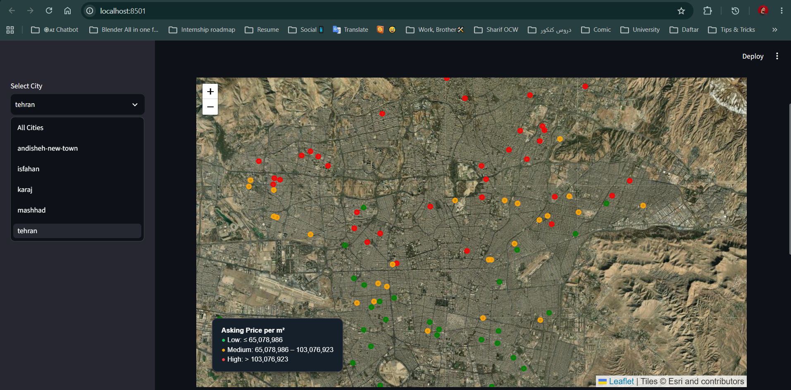

# Iranian Real Estate Market Analysis | PostgreSQL, PostGIS & Python

A hands-on exploration of Iranian apartment asking prices using real-world real estate advertisements from **Divar**. This project started as a way to put the SQL concepts I learned from *Practical SQL, 2nd Edition: A Beginner's Guide to Storytelling with Data* by **Anthony DeBarros** into practice—and grew into an end-to-end data analysis project with a geographic visualization.

## Final visualization



*Final map created with PostGIS and pgAdmin's Geometry Viewer. Points are reported listing coordinates and may represent approximate areas rather than exact property addresses.*


## Project goals

- Import and explore a large, real-world dataset in PostgreSQL.
- Clean inconsistent values and distinguish usable data from suspicious records.
- Compare apartment asking prices across **Tehran, Mashhad, Karaj, Isfahan, and Andisheh New Town**.
- Analyze neighborhood-level differences and price per square meter.
- Explore geographic coverage and visualize available locations with PostGIS.
- Experiment with a small Python/Streamlit web dashboard as an additional learning exercise.

## Dataset

**Source:** [Divar — Real Estate Ads on Hugging Face](https://huggingface.co/datasets/divarofficial/real_estate_ads)

The original import contained approximately **1 million advertisements**. For this project, I focused on residential apartments listed for sale in five cities. After an initial cleaning pass, the analysis subset contained **154,182 advertisements**. A geographic view contained approximately **109,015 advertisements** with usable coordinate pairs.

These are **advertised asking prices**, not verified sale transactions. Monetary units should be confirmed against the source metadata before interpreting reported price values as a particular currency. The dataset may contain inaccurate listings, placeholders, repeated locations, or approximate geocoordinates.

## Tools and techniques

| Tool | Role |
| --- | --- |
| PostgreSQL / pgAdmin | Data import, SQL querying, cleaning, analysis |
| PostGIS / Geometry Viewer | Geographic point creation and map visualization |
| Python / Pandas / SQLAlchemy | Reading database views into Python |
| Streamlit / Folium | Experimental interactive dashboard (extra work beyond the book) |

SQL concepts practiced include filtering, joins, aggregation, `CASE`, `NULL` handling, common table expressions (CTEs), views, window functions, percentiles, and geographic queries.

## Workflow

1. **Explore and import** the dataset into PostgreSQL.
2. **Select** apartment-for-sale listings in the five target cities.
3. **Clean** selected records, including area, price, and construction-year fields.
4. **Analyze** listing counts, median asking prices, and price per square meter.
5. **Compare neighborhoods** using grouped statistics and ranking functions.
6. **Check location quality**, including missing coordinates and reported location radii.
7. **Visualize points** using PostGIS and pgAdmin; separately experiment with a Python web dashboard.

## Selected findings

- The cleaned five-city apartment subset contained **154,182 listings**.
- About **109,015 listings (70.71%)** had both geographic coordinates available.
- In the analyzed subset, **Andisheh New Town had no populated `neighborhood_slug` values**, so it could not be included in neighborhood rankings.
- Some advertisements shared coordinates, and `location_radius` was often either missing or set to a nonzero value. **Map points should not be interpreted as verified building locations.**
- Extreme listing prices can distort averages; medians and percentile-based sensitivity checks are useful for comparisons.

These are exploratory findings from the selected dataset, **not** conclusions about the entire Iranian housing market.

## Repository structure

```text
Divar-Iran-Real-Estate-Analysis/
├── housing_dashboard/
│   ├── app.py
│   ├── database.py
|   └── requirements.txt
├── screenshots/
│   └── tehran_housing_map.png
├── 1 - Divar's Iranian Real Estate Market Analysis.sql
├── data_README.md
├── Divar's Iranian Real Estate Market Analysis.ipynb
├── real_estate_ads.csv
├── .gitignore
└── README.md
```


## Reproducing the project

1. Install PostgreSQL and pgAdmin; enable PostGIS if you want to run the map queries.
2. Obtain the data from the original [Divar Hugging Face dataset](https://huggingface.co/datasets/divarofficial/real_estate_ads), subject to its terms and license.
3. Create a local database and run the SQL scripts in the `sql/` folder in order, adapting local CSV paths and import settings.
4. To try the optional Python dashboard, create a virtual environment, install `requirements.txt`, and configure a local `.env` with `DB_HOST`, `DB_PORT`, `DB_NAME`, `DB_USER`, and `DB_PASSWORD`. Run `streamlit run housing_dashboard/app.py` from the project root if your imports and paths are configured accordingly, or run it from the `housing_dashboard/` directory.

**Security:** Never commit `.env`, credentials, or large raw data exports. The database itself is not included in this repository.

## Acknowledgments ❤️

A heartfelt thank-you to **Anthony DeBarros** for writing *Practical SQL, 2nd Edition: A Beginner's Guide to Storytelling with Data*. The book gave me a clear, practical foundation and inspired me to learn by working through a real dataset rather than stopping at textbook exercises.

I'm also sincerely grateful to **Divar** for collecting real-world housing advertisement data and making it accessible through its **[Hugging Face dataset page](https://huggingface.co/datasets/divarofficial/real_estate_ads)**. Sharing data like this creates valuable learning opportunities for students and independent learners like me.

**Scope note:** The core database work—SQL analysis, cleaning, statistics, and views—was guided by what I studied in *Practical SQL*. Building a **Python-powered web interface / dashboard and integrating it with the database** was an independent extension **outside the scope of the book**, not a feature taught by it.

## Limitations

This is a learning and portfolio project, not a property valuation service. Asking prices may not reflect actual transaction prices; some listings may be erroneous or repeated; and coordinates can be incomplete or intentionally approximate. Map imagery and dataset reuse are subject to their respective providers' terms.
